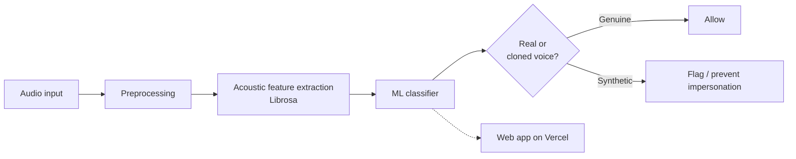
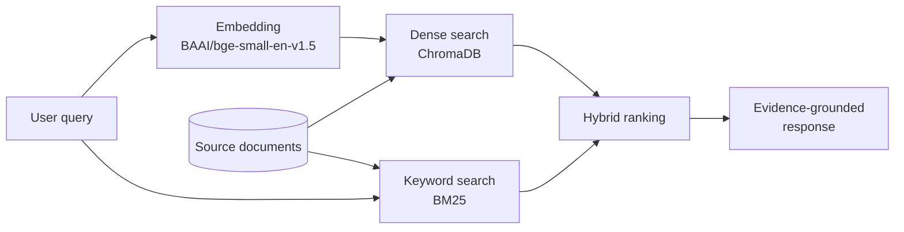
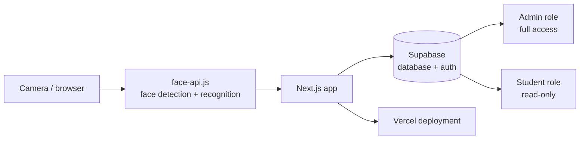

<h1 align="center">👋 Hi, I'm Pulkit Sharma</h1>

  🤖 AI/ML Engineer | Generative AI • RAG • Machine Learning • Python

  

  
  
  
  

---

## 👨‍💻 About Me

- 🎓 3rd-year B.Tech CSE (AI & ML) at **Career Point University, Kota** | CGPA **9.94+**
- 🏅 **AWS Certified AI Practitioner**
- 🥇 1st place, internal hackathon at CPU | Gold medal, IEEE Debate & Presentation
- 🏛️ President, **IPR Cell** at Career Point University
- 🌱 Currently learning: Generative AI, AI Agents, MLOps
- 🎯 Goal: build AI systems that solve real problems, and grow into a top-tier AI/ML engineering role

---

## 🖥️ Tech Stack

**Languages**

**AI / ML / Generative AI**

**Backend, Cloud & Databases**

**Frontend & Tools**

**Also:** ChromaDB • BM25 • Librosa • Embeddings • Semantic Search • Hybrid Retrieval • REST APIs • **System Design**

---

## 🚀 Featured Projects

| Project | What it does | Tech |
|---|---|---|
| 🎙️ [**VoiceGuardAI**](https://github.com/pulkitbuilds/voiceguard2-) · [Live](https://voiceguard2.vercel.app) | Real-time platform that detects and prevents voice-cloning impersonation attacks | Python, Librosa, ML classification, Vercel |
| 📚 [**Evidentia**](https://github.com/pulkitbuilds/Evidentia-Evidence-first-editor) | Evidence-first editor backed by a hybrid RAG pipeline that grounds output in source documents | ChromaDB, BM25, sentence-transformers (`bge-small-en-v1.5`) |
| 🧑‍🎓 [**Face Attendance System**](https://github.com/pulkitbuilds/Facial_Attendence) | Face-recognition attendance web app with admin and read-only student roles | Next.js, Supabase, face-api.js, Vercel |

---

## 🏗️ System Design

High-level architecture of each project.

### 🎙️ VoiceGuardAI: real-time voice-clone detection

**Key ideas:** end-to-end audio ML pipeline, signal processing, low-latency inference, deployed as a live web app.

### 📚 Evidentia: evidence-first hybrid RAG

**Key ideas:** dense + sparse retrieval fused into one ranking, so answers stay tied to real source evidence instead of unsupported generation.

### 🧑‍🎓 Face Attendance System

**Key ideas:** role-based access control, client-side face recognition, managed backend.

---

## 🏆 Achievements & Certifications

- 🥇 1st Place: Internal Hackathon, Career Point University
- 🥇 Gold Medal: IEEE Debate & Presentation
- 🥇 Gold Medal: University Table Tennis Event
- 🎓 Certificate of Excellence: Academic Achievement
- ☁️ AWS Certified AI Practitioner
- 📊 Google Data Analytics Professional Certificate
- 🤖 Machine Learning Certification (Udemy)
- 🤖 Machine Learning / AI Certification (IIT Bombay Techfest)

---

## 📊 GitHub Stats

  
  

  

---

  💡 <i>"Learn. Build. Iterate. Repeat."</i>

